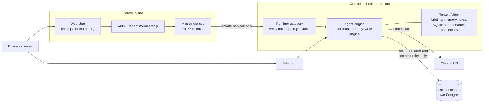

# AIgentSmith: architecture case study

AIgentSmith is an agent platform I designed and built for small service businesses. Each business gets its own AI operator: an agent that reads the business's live data, remembers how the business works, and makes changes to that data only after the owner confirms them. The owner talks to it over web chat or Telegram.

This repo is a case study. The code is private; what is here is the architecture, the security model, the testing approach, the main decisions and what I learned. Snippets are small and illustrative.

## The problem

A general-purpose assistant answers a question inside one session and forgets it. An owner who wants an agent to *run* part of the business needs something different:

- It has to read the real systems (bookings, leads, stock, invoices, the website CMS), not a copy.
- It has to remember the business across sessions.
- It has to be allowed to change things, which is where most of the risk sits.
- Several businesses run on the same platform, and none of them can ever see another's data or memory.

The hard part is the third and fourth points. Most of the engineering in AIgentSmith goes into making writes safe and tenants sealed, and into proving both with tests rather than asserting them.

## Architecture at a glance

Four ideas carry the design:

1. **One sealed unit per tenant.** Each tenant is a folder (briefing, memory, SQLite store, permissions charter, connector config) run by its own engine process, in its own container with default-deny egress. There is no shared process that can read more than one tenant.
2. **The business's data never moves.** The agent reaches the business's own database through narrow Postgres roles: a read-only role for queries and a commit role that can only touch named columns.
3. **Tools are data, not code.** Each tool the agent can call is a declarative config (name, typed params, allowlisted relation, columns, filters). The engine turns it into parameterised SQL. There is no generic SQL tool.
4. **Every write is propose, confirm, commit, undo.** The agent can only stage a change and show a card. The owner confirms; a deterministic path (not the model) commits it in one transaction with an audit row. Every write has an undo.

## Read more

| Doc | What it covers |
|---|---|
| [docs/architecture.md](docs/architecture.md) | Components, the life of a chat turn, the write path, memory, the module shelf, deployment |
| [docs/security-model.md](docs/security-model.md) | Threat model, tenant isolation, how agent tool access is controlled, prompt-level invariants |
| [docs/evals-and-testing.md](docs/evals-and-testing.md) | The eval pack, deterministic oracles, database-level fence tests, CI |
| [docs/decisions.md](docs/decisions.md) | Ten architecture decisions with context, alternatives and tradeoffs |
| [docs/lessons.md](docs/lessons.md) | What went wrong, what I would keep, what I would change |

## Stack

- **Engine and gateway:** TypeScript on Deno, Anthropic SDK (a Sonnet-class model for conversation, a Haiku-class model for memory distillation and classification), SQLite per tenant.
- **Control plane and business app:** Next.js, React, Supabase Auth, Postgres with row-level security.
- **Business data:** Postgres, reached through dedicated roles and column-level grants.
- **Runtime:** rootless Podman containers under systemd, nftables egress rules, encryption at rest, continuous SQLite replication to encrypted object storage.
- **Quality:** Deno test, golden corpora, property tests, a live-model eval pack, database-level fence harnesses on real Postgres, GitHub Actions, gitleaks.

## Scale of the work

From the private repository: about 350 commits across roughly two and a half months (July to September 2026), around 560 test declarations in the engine alone, eight installable modules, and twelve CI jobs. Every non-trivial change had a written design reviewed from product, architecture, QA and AI-security angles before code. Those reviewers are AI agent roles that I direct, one each for product, architecture, QA and AI security.

## Status

The engine, gateway, control plane, module shelf and write machinery are built and were exercised on real business data during a pilot. Demos run on a local deployment.

## Author

Diego Bauer, AI Product Manager and Technical Product Owner, Dublin.
[www.aiwithdiego.com](https://www.aiwithdiego.com) · [LinkedIn](https://www.linkedin.com/in/diego-bauer-domeyko/)

See [LICENSE](LICENSE). The documentation is published for reading; the code is private.
