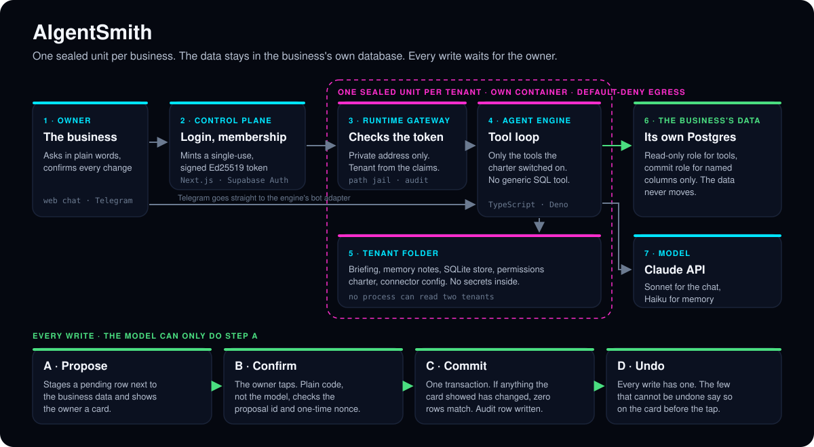

# aigentsmith-architecture

**An AI operator for small businesses. Every write waits for the owner.**

[](docs/architecture.md)
[](docs/decisions.md)
[](https://github.com/AIwithDiego/aigentsmith-architecture/actions/workflows/ci.yml)


[](LICENSE)

[](docs/architecture.md)

A case study of AIgentSmith, the agent platform I designed and built for small service businesses. Built in Dublin with Claude Code, July to August 2026: 352 commits in seven weeks, 562 tests in the agent engine, run on real business data during a pilot. The code is private; this repo holds the architecture, the security model, the decisions and what went wrong.

**[Read the architecture](docs/architecture.md)** · **[See what went wrong](#what-went-wrong)** · [Security model](docs/security-model.md) · [Ten decisions](docs/decisions.md)

**Contents:** [The problem](#the-problem) · [Research](#research) · [What it does](#what-it-does) · [Results](#results) · [The build](#the-build) · [What went wrong](#what-went-wrong) · [What I learned](#what-i-learned) · [Run it yourself](#run-it-yourself)

## The problem

A general-purpose assistant answers a question inside one session and forgets it. An owner who wants an agent to run part of the business needs more than that:

- **It has to read the real systems** (bookings, leads, stock, invoices, the website CMS), not a copy.
- **It has to remember the business** across sessions.
- **It has to be allowed to change things**, and that is where most of the risk sits.
- **Several businesses share the platform**, and none of them can ever see another's data or memory.

The last two are the hard part. Most of the engineering in AIgentSmith went into making writes safe and tenants sealed, and into proving both with tests.

> Chat assistants can talk about your business. This one is allowed to change it, so the safety has to live somewhere the model can't reach.

## Research

**What already exists.** Chat assistants with connectors read a few tools and forget between sessions. Agent frameworks make it easy to hand the model a "run SQL" tool or a broad API key, which turns every prompt injection into a query. Multi-tenant SaaS usually means one shared service with a `tenant_id` filter on every query, where one missed filter puts one business's memory in another's conversation.

**Who it's for.** The owner of a small service business who will never read a log. Every screen and every sentence the agent says had to be true for that person, including what it can and cannot do right now.

**The limits we chose.** The model never commits anything; it can only propose. A capability that is switched off is a tool that does not exist, not an instruction to refuse. The last fence lives in Postgres, so an engine bug produces a failed write instead of a bad one. Evals use exact-string oracles, not a judge model. All ten are written up in [docs/decisions.md](docs/decisions.md).

**What I didn't build.** A shared multi-tenant service ([ADR-01](docs/decisions.md#adr-01-one-sealed-unit-per-tenant-not-a-shared-multi-tenant-service)), a generic SQL tool ([ADR-02](docs/decisions.md#adr-02-tools-are-declarative-config-and-there-is-no-generic-sql-tool)), "always allow" settings ([ADR-03](docs/decisions.md#adr-03-every-write-is-propose-confirm-commit-with-state-in-the-businesss-database)), a public runtime API ([ADR-04](docs/decisions.md#adr-04-the-runtime-gateway-lives-inside-the-engine-and-the-control-plane-signs-its-tokens)) and an LLM judge ([ADR-07](docs/decisions.md#adr-07-deterministic-oracles-instead-of-an-llm-judge)).

## What it does

Each business gets its own AI operator. The owner asks in plain words over web chat or Telegram. The agent reads the business's live data, remembers how the business works, and changes data only after the owner taps confirm on a card that shows exactly what will change.

| | What it does | How it is enforced |
|---|---|---|
| **Sealed tenants** | One folder, one engine process, one rootless container per business | No shared process can read two tenants; a host check asserts no tenant's OS user can read another's folder |
| **Data stays put** | Reads and writes the business's own Postgres | A read-only role, and a commit role limited by column-level grants |
| **Tools are data** | Each tool is a config entry: allowlisted table, fixed columns, typed params | The engine builds parameterised SQL; there is no generic SQL tool |
| **Consent on every write** | Propose, confirm, commit, undo | The model can only stage; plain code binds the confirm to one proposal and a one-time nonce |
| **Stale cards refused** | If anything the card showed has changed, nothing is written | A hash of the declared readback columns is re-checked inside the commit statement |
| **Honest about itself** | The prompt and the screens list only what the agent can do right now | Both derive from the same state that gates execution |



1. **Control plane** ([architecture](docs/architecture.md#control-plane)): login, tenant membership, and a single-use Ed25519 token minted per request. Next.js and Supabase Auth.
2. **Runtime gateway** ([architecture](docs/architecture.md#runtime-gateway)): inside the engine process, on a private address only. Verifies the token and takes the tenant from its claims, never from the request.
3. **Agent engine** ([architecture](docs/architecture.md#agent-engine)): the tool loop, memory distillation and the write engine. TypeScript on Deno, Claude Sonnet for the conversation, Claude Haiku for memory and classification.
4. **Tools as data** ([architecture](docs/architecture.md#tools-as-data)): the tenant's whole read surface is one reviewable file.
5. **The write path** ([architecture](docs/architecture.md#the-write-path)): pending rows and the audit log live next to the business data, so a commit is one transaction.
6. **The module shelf** ([architecture](docs/architecture.md#the-module-shelf)): eight installable modules (CRM, jobs, staff, inventory, billing, media, CMS, social), each with a manifest checked against the live database.

## Results

These come from the private repository and from the pilot. They can't be reproduced from here, because the code is private.

- **Size of the work.** 352 commits between 9 July and 26 August 2026, 562 test declarations in the engine, eight modules and twelve CI jobs.
- **Regressions on a dashboard rewrite.** Deployed to both live tenants with 0 regressions across 108 probes, diffed against fixtures captured before a line was written.
- **What a conversation turn costs.** Measured from one pilot tenant's own call records, not estimated: about $0.067 per turn, or about $16 a month for an owner who sends eight messages a day. 85% of the bill is input tokens; output is 7%. The fixed preamble (tool definitions plus system prompt) is 11,889 tokens on every call. Prompt caching was already on, which saved a day of work spent adding it. The real waste was cache writes: 27% of spend, because the five-minute cache expires between an owner's messages.

## The build

Every non-trivial change started with a written design, reviewed separately from product, architecture, QA and AI-security angles, with conflicts settled in writing before code. Those reviewers are AI agent roles I direct (the AI-security one is public: [hank](https://github.com/AIwithDiego/hank)). The code was written with Claude Code, in small pull requests on feature branches.

| When (2026) | What landed | Read more |
|---|---|---|
| 9 Jul | First design doc and four design reviews, before any code | [The build process](docs/lessons.md#multi-reviewer-design-pays-for-itself-on-outage-shaped-bugs) |
| 10 Jul | Database roles, the declarative tool executor and eight read tools, Telegram, the first eval pack | [Tools as data](docs/architecture.md#tools-as-data) |
| 11 to 15 Jul | The write engine: propose, confirm, commit, then undo for every write | [The write path](docs/architecture.md#the-write-path) |
| 16 to 17 Jul | Sealed tenant units: tenant folder storage, rootless containers, encrypted volume, Ed25519 tokens, the runtime gateway, web chat | [ADR-01](docs/decisions.md#adr-01-one-sealed-unit-per-tenant-not-a-shared-multi-tenant-service), [ADR-04](docs/decisions.md#adr-04-the-runtime-gateway-lives-inside-the-engine-and-the-control-plane-signs-its-tokens) |
| 24 to 29 Jul | A second tenant with writes, capability honesty, a working kill switch | [Capability honesty](docs/security-model.md#capability-honesty) |
| 10 Aug | The module shelf gets a contract and its first fence test that you can watch fail | [ADR-09](docs/decisions.md#adr-09-modules-use-table-prefixes-not-postgres-schemas) |
| 13 to 14 Aug | The readback signature replaces the version column, in three steps | [ADR-08](docs/decisions.md#adr-08-a-readback-signature-instead-of-a-version-column) |
| 20 Aug | Cost measured per turn before any optimisation | [Results](#results) |
| 21 to 26 Aug | The owner's panel redesigned around the agent, with a mobile shell | not in these docs |

## What went wrong

| | |
|---|---|
| **A green check proved nothing.** Write-fence tests read a git-ignored file, so in CI they never ran, and main was red for five merges before anyone saw why. | [lessons](docs/lessons.md#a-green-check-proves-nothing-until-you-have-seen-it-fail) |
| **Templates leak.** For a while every tenant was served the first tenant's system prompt, written during the single-tenant phase. | [lessons](docs/lessons.md#templates-leak) |
| **The UI promised writes the engine could not do.** A read-only tenant's dashboard listed write tools by name, because the screens read config instead of the live wiring. | [lessons](docs/lessons.md#the-ui-can-lie-even-when-the-engine-is-correct) |
| **The stale-write guard watched the wrong row.** A version column guarded the edited row, but cards render from views that join other tables, so a page published mid-confirm went unnoticed. | [ADR-08](docs/decisions.md#adr-08-a-readback-signature-instead-of-a-version-column) |
| **Undo said the record had changed when it hadn't.** The two halves of one audit row were made two different ways, so `20` never matched `20.00`. | [lessons](docs/lessons.md#two-halves-of-one-audit-row-made-two-different-ways) |
| **The agent answered from its briefing.** No tool exposed a table, so the model listed three packages out of five from the prompt and sounded certain. | [lessons](docs/lessons.md#no-tool-for-a-table-means-the-agent-answers-from-its-briefing) |
| **A kill switch with no key.** The pause-writes switch failed on the tenant that most needed it; the warning had been in the boot log every time. | [lessons](docs/lessons.md#a-kill-switch-with-no-key) |
| **A security sensor reported healthy while blind.** The console's brute-force jail said ACTIVE with zero failures while it tailed an empty file. | [lessons](docs/lessons.md#a-sensor-that-reported-healthy-while-blind) |
| **The obvious repair would have broken production.** Replaying old migrations to restore a lost write layer would have caused three silent faults. | [lessons](docs/lessons.md#the-obvious-repair-would-have-broken-production-three-ways) |
| **Firewalls drift like docs do.** The default-deny egress rule was missing in production for four days, and later an allowlist change reached one box and not the other. | [lessons](docs/lessons.md#documentation-drifts-from-production-quietly) |

## What I learned

- **Watch a fence fail before you trust it.** Every new check is now run red against the unfixed system first, with a control arm so a check that fails everything can't look healthy.
- **Put the last fence where the data is.** Engine checks give good error messages; Postgres grants and policies are what hold when the engine has a bug.
- **Take away the tool instead of forbidding it.** A refusal in a prompt is probabilistic. A tool that never loads can't be called.
- **Anything written for one tenant is suspect until a second tenant runs it.** Timezone, navigation and prompt identity all had to be un-hardcoded later.
- **Deploys should ask, not assume.** The worst bugs here were things that were true on one box, in one doc or in one log line, and not where it mattered.
- **Four reviews before code is slower, and cheaper than the outage.** On one change, two of the four problems the reviews found would have silently stopped all writes on live tenants.

**What's next:** The patterns here (consent cards, database fences, honest capability lists) carry into what I build next.

## Ground rules

- **Architecture, decisions and lessons only.** No code from the private repo; the snippets in the docs are small and illustrative.
- **No tenant, client or personal data.** Businesses are described by type, never by name. No internal URLs, hostnames or project IDs.
- **Real numbers or none.** Every figure comes from the private repo's history or the pilot's own records.

## Run it yourself

There is nothing to run: the code is private. Read it in this order instead.

1. [docs/architecture.md](docs/architecture.md): the components and the life of one chat turn.
2. [docs/security-model.md](docs/security-model.md): the threat model, tenant isolation and the five layers of tool access.
3. [docs/decisions.md](docs/decisions.md): ten decisions, each with what was rejected and what it cost.
4. [docs/evals-and-testing.md](docs/evals-and-testing.md): the eval pack, the oracles and the database fence harnesses.
5. [docs/lessons.md](docs/lessons.md): what went wrong, in detail.

## Repo map

```
README.md                  this case study
docs/
  architecture.md          components, the chat turn, the write path, memory, modules, deployment
  security-model.md        threat model, isolation, tool access, prompt invariants
  evals-and-testing.md     eval pack, oracles, fence harnesses, CI
  decisions.md             ten architecture decisions
  lessons.md               what went wrong and what I'd change
  how-it-works.svg         the diagram above
  assets/                  social preview
  src/                     HTML source of the social preview
.github/                   CI (gitleaks), issue and PR templates
```

## Credits

Built with [Claude Code](https://claude.com/claude-code) and the [Claude API](https://docs.anthropic.com). Runs on [Deno](https://deno.com), [Postgres](https://www.postgresql.org), [Supabase](https://supabase.com) Auth, [Podman](https://podman.io) and [SQLite](https://sqlite.org). Secret scanning by [gitleaks](https://github.com/gitleaks/gitleaks). Design reviews by four AI agent roles, one of them public as [hank](https://github.com/AIwithDiego/hank).

## Licence

Documentation published for reading; all rights reserved. See [LICENSE](LICENSE). · Made in Dublin by [Diego Bauer](https://www.aiwithdiego.com) · [LinkedIn](https://www.linkedin.com/in/diego-bauer-domeyko/)

Built by [AIwithDiego](https://www.aiwithdiego.com). Need something like this for your team? [Talk to me](https://www.aiwithdiego.com).
