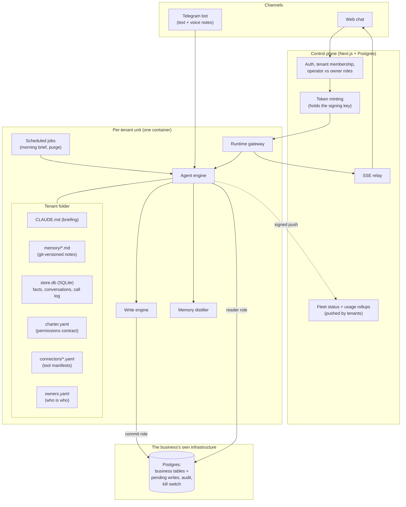
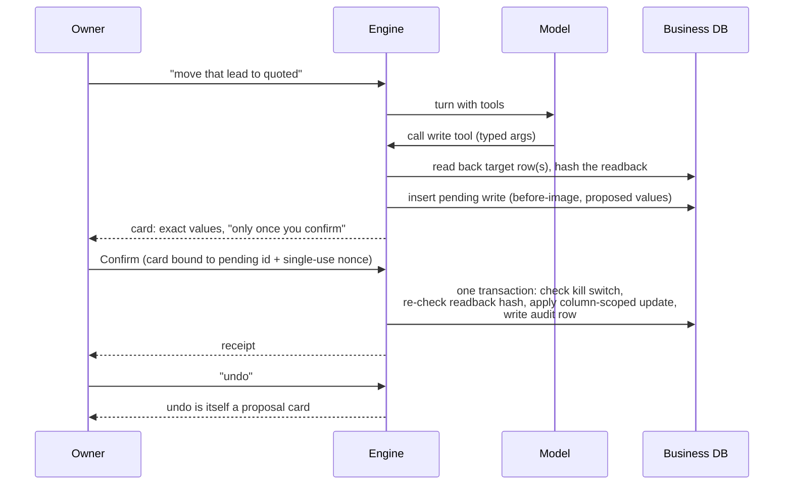
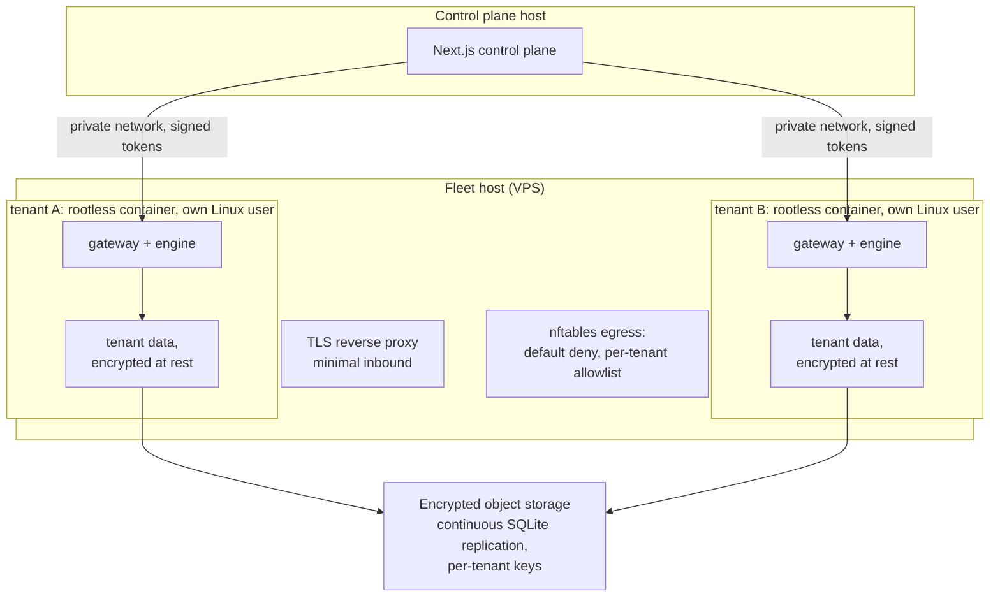

# Architecture

This document walks through the parts of AIgentSmith and how a request moves through them. Security properties are summarised here and covered in depth in [security-model.md](security-model.md).

## Components



### Control plane

A Next.js app with its own small Postgres. It owns identity (who can log in, which tenant they belong to, whether they are the operator or the business owner), mints capability tokens for the runtime, and relays the streamed reply back to the browser. It never holds a business's data and never holds a tenant's model key. The browser only ever talks to the control plane; it has no route to a tenant unit.

### Runtime gateway

A small HTTP server that runs **inside** the engine process for each tenant, bound to a private network address only. It exposes an exhaustive list of routes (chat, chat history, memory notes and their versions, learned facts, usage, the read-only charter, health). Anything not on the list does not exist. Every request carries a single-use token signed by the control plane; the gateway holds only the public verification key.

```ts
// Shape of the claims inside a gateway token (illustrative).
interface TokenClaims {
  tenant: string;                                  // must equal the gateway's own tenant
  actor: { id: string; role: "operator" | "owner" };
  verbs: string[];                                 // exact match, e.g. "chat:send", "memory:read"
  paths: string[];                                 // file scopes, e.g. "memory/*"
  exp: number;                                     // short TTL
  jti: string;                                     // burned on first use
}
```

Request order is fixed: authenticate before touching the filesystem, burn the `jti`, rate-limit, route, check verb and role and path scope, apply the path jail, then run the handler. Every request is appended to a per-tenant audit log.

### Agent engine

The engine runs the tool-use loop against the Claude API. For each turn it:

1. Queues the turn behind any other turn for the same tenant (one at a time, so the same owner on web and Telegram cannot interleave).
2. Snapshots the briefing and memory at turn start. Edits made mid-turn apply to the next turn.
3. Assembles the prompt: a fixed safety spine held in engine code, tenant-authored slots (identity, voice, capability enumeration), a volatile block with the tenant-timezone date, and recalled memory.
4. Exposes only the tools that survive the charter and the connector allowlist.
5. Runs the loop, executes tool calls through the declarative executor, and streams the reply.
6. Records cost and latency per call and per channel.

### Tools as data

Tools are declared in connector YAML, not written as code. The executor validates every identifier against a strict pattern and the connector's relation allowlist at load time, binds every model-supplied value as a parameter, and clamps every result to a hard row cap.

```ts
// A read tool, as the engine sees it (trimmed).
interface ToolConfig {
  name: string;
  description: string;
  kind: "query" | "view";          // complex aggregates live in DB views
  from: string;                    // must be in the relations allowlist
  params?: Record<string, { type: "string" | "number" | "boolean" | "date"; enum?: string[] }>;
  filters?: { col: string; op: "eq" | "lt" | "gte" | "in" | "search"; param?: string }[];
  columns: string[];
  order?: string;                  // validated against a strict pattern
  cap?: number;                    // clamped to the hard cap regardless
}
```

A new tenant is mostly a new connector file plus database grants, not new engine code.

### The write path

The model never writes to a business table. A write tool stages one pending row and renders a confirmation card from a read-back of the target. Confirmation is deterministic code, not a model decision.



Details that matter:

- A card is bound to one pending write by id and a single-use nonce. A stale button cannot confirm a newer proposal.
- Pending proposals expire after a few minutes and live only in memory plus the pending-writes table. If the container dies, unconfirmed work is dropped; committed state only ever exists in the business's database.
- The kill switch lives in the business's own database and is checked inside the same transaction as the write.
- At commit, the engine re-computes a signature of the propose-time readback. If anything the card showed has changed, including joined rows in other tables, the update matches zero rows and the owner gets a fresh card instead of a silent write against stale information.
- Undo restores the before-image through the same confirm machinery. It has no special powers.

### Memory

Memory has three layers with different owners and different trust levels.

| Layer | Stored as | Who edits it | Trust |
|---|---|---|---|
| Briefing | `CLAUDE.md` in the tenant folder | Operator only | Trusted, part of the prompt |
| Notes | `memory/*.md`, one git commit per edit | Operator and owner, via the gateway, with compare-and-swap | Data tier |
| Learned facts | Rows in `store.db`, written by a distiller after conversations | The distiller writes; the owner can invalidate and restore | Data tier, with provenance |

The distiller never promotes facts into the briefing. Owner deletes are soft (invalidate and restore). Hard erasure for data-protection requests is a separate operator-only flow. Notes history is append-only: restoring an old version creates a new commit.

Recall is ranked by importance and recency today. There is a recall@k eval pack written so that query-aware retrieval can be dropped in and measured against the same labels (see [evals-and-testing.md](evals-and-testing.md)).

### The module shelf

To avoid building every tenant's back office from scratch, common business capabilities are packaged as modules: CRM, jobs, staff, inventory, billing, media, CMS and social scheduling. A module is a directory whose manifest is the contract:

```yaml
# module.yaml (illustrative, trimmed)
module: crm
version: 1
intended_purpose: >-
  Let the owner see and move a sales pipeline in conversation.
known_limitations: >-
  Stages are fixed at install time. No de-duplication. Contact details are never writable.
relations:
  pipeline_deals:
    kind: table
    columns: { id: uuid, stage: deal_stage, follow_up_date: date, value_cents: integer }
    money_units: { value_cents: cents }
grants:
  reader: [pipeline_deals, pipeline_notes]
  commit:
    pipeline_deals: { update: [stage, follow_up_date, value_cents] }
never_write: [pipeline_deals.contact_email, pipeline_deals.created_at]
```

Tooling reads the manifest and generates the connector fragment, the database fence proof and a surface hash. A schema-diff tool asserts every declaration against `pg_catalog`. Modules install into a tenant in a fixed order: structure, grants, policies, fixtures, then the fence proof, which runs last because its behavioural leg needs a real row to move.

Each module also ships in a reference business app (Next.js), so the demo is two screens: the chat where the owner asks for a change, and the business software where the change appears.

### Proactive work

A scheduled job builds a morning brief from the same tools the agent uses in chat, with a deterministic fallback renderer if the model call fails. The agent initiates; it is not only a prompt box.

### Media processing

Images uploaded through chat are transcoded in an isolated sandbox process: no network, capped memory, one image at a time, a hard deadline, killed on overrun. The parent process never decodes an image; it only moves bytes over a Unix socket. The reasoning is that image decoders are where memory-safety bugs live, so the code that runs them gets nothing worth exploiting.

## Deployment



- One rootless container and one Linux user per tenant, with memory and CPU limits and no socket mounts.
- Secrets are injected at start from encrypted files and never live in the tenant folder, so snapshots and exports are secret-free by construction.
- Egress is default-deny per tenant, with hostnames added one at a time after review.
- The gateway is never public. Only the control plane's server side can reach it.
- Deleting a tenant means deleting its folder and git history, deleting its replica, and destroying its backup keys.

The engine also runs directly on a laptop with no container (an environment variable points it at a folder), which is how the local demo works. The container was a tenancy decision for a shared host, not a requirement of the program.
