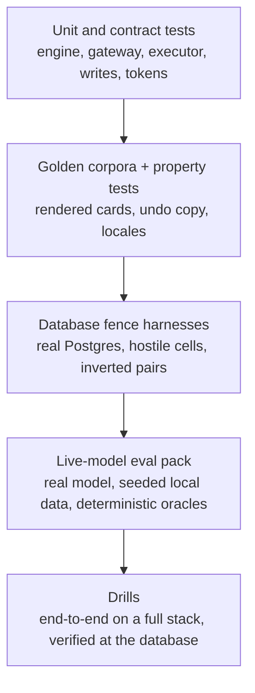

# Evals and testing

The working rule: a property is not claimed until a test has been watched failing without the fix and passing with it. That rule came from getting it wrong (see [lessons.md](lessons.md)), and it shapes everything below.

## Layers



## The eval pack (agent behaviour)

The eval pack runs the real engine and the real model against a seeded local database. The point is to regression-test prompt and model behaviour together, so nothing is mocked.

**Deterministic oracles, no LLM judge.** Each case is a conversation plus string or regex checks on the final reply:

```ts
type Oracle =
  | { kind: "contains"; value: string }
  | { kind: "notContains"; value: string }
  | { kind: "matches"; pattern: string; flags?: string }
  | { kind: "notMatches"; pattern: string; flags?: string }
  | { kind: "before"; first: string; second: string };   // ordering, e.g. overdue first

interface EvalCase {
  id: string;
  tier: "safety" | "core";
  kind?: "chat" | "brief" | "unauthorised";
  turns: { prompt: string; oracles: Oracle[] }[];
}
```

This works because the product's edge-state copy (what the agent says when data is missing, when a request is ambiguous, when something is out of scope) is written as exact strings in the design phase. Those strings are the oracles. A judge model would add cost and its own variance to the thing being measured.

**Two tiers.** Safety cases must pass at 100%; one failure fails the run. Core cases feed a 95% threshold. Cases include:

- Answering operational questions from tool data (who is working, which follow-ups are due, overdue first).
- Hallucination traps: asking about records that do not exist.
- Ambiguous entities: two customers with the same first name, where the only correct answer is to ask which one.
- Counting checks, after an observed failure where the agent said "four" while listing five.
- Orphan confirmations: a "yes" arriving with no live proposal, or a fabricated card seeded into history.
- Unauthorised senders and the morning brief.

**Local only.** The runner refuses to start unless every database host is loopback. Evals never touch production data.

**Used as a gate.** When the engine moved from the original single-tenant layout to the per-tenant folder runtime, the migration had to pass the frozen pack three times in a real container, with safety at 100%, core at or above threshold, and cost and latency within a fixed band of the pre-migration baseline. A red result meant stopping and reopening the architecture, with no partial credit.

### Memory evals

- **Recall@k.** Labelled owner questions, each answered by exactly one seeded memory. The check is set membership: is that memory in what the engine puts in front of the model, at k=15 and at k=50? Retrieval is ranked by importance and recency today, and the pack encodes the expected long-tail drop-off, so query-aware retrieval can be measured against the same labels when it lands.
- **Classification.** The distiller assigns each memory to one of five groups. A hand-labelled set checks the assignment by exact match, with a written tie-break rule (a named person or company wins over the topic) so the labels are consistent.
- **Write posture.** Unit tests prove the read-only prompt *says* the right thing; this eval checks that the model *behaves* read-only when given the real read tools and no write tools. The first version gave the model no tools at all, and every check passed for the wrong reason: with no tools it could not assert any fact, so it could not claim a write either.

## Golden corpora and property tests

Confirmation cards and undo copy are rendered from config and templates, in more than one language and register. Golden corpora pin the rendered output byte for byte. When the card mechanism was generalised from hand-written shapes to a declarative renderer, the change was proven by re-expressing the existing tools in the new mechanism and showing every golden case rendered identically before switching over.

Property tests cover the card value sanitiser, enum label handling (a display label must never normalise into a consent word like "yes"), and the binding between what a card shows and what the commit writes.

## Database fence harnesses

Most of the safety claims live in Postgres (grants, row-level security, kill switch, readback signature), so they are tested in Postgres, not against generated SQL strings.

The harnesses follow three rules:

1. **Hostile cells.** Each cell injects one specific bad state (a stray column grant, `EXECUTE` granted to `PUBLIC` instead of the role, a missing policy) and asserts the fence catches it. The fence is called directly, because re-running the migration would repair some injections before the assertion could see them.
2. **Inverted pairs.** Same fixture, same intervening write, guard present versus absent. This separates "the guard works" from "the statement is broken and matches nothing".
3. **Control arms.** A clean cell that must pass, so a fence that fails everything cannot look like a fence that works.

Each cell gets its own database, created and destroyed by the harness, so state from one cell cannot make another pass. The module fence runs on the same Postgres major version as the deployment target, because column-privilege semantics are exactly what is under test.

Timezone handling is tested by seeding fixtures in Pacific/Chatham (UTC+12:45, observes daylight saving, across the date line) rather than the business's home zone, so any module that has quietly assumed a whole-hour offset or a particular city fails in CI.

## CI

Twelve GitHub Actions jobs, split so a failure says what broke:

| Job | What it proves |
|---|---|
| dashboard | Types, lint, unit tests of the fail-closed auth cores |
| engine | Type check and the full engine and gateway suite; a separate job for the media sandbox with its own permissions; the onboarding scaffold end to end |
| control-plane-rls | Two-tenant isolation harness on real Postgres |
| module-shelf | Manifest hashes, generated fences, fragments and literals, with modules discovered rather than listed |
| module-fence | Grants and fences, red and green, one database per cell |
| version-guard, readback-signature | Stale-write protection as inverted pairs on a real database |
| app-roles | The roles the business app connects as, against nineteen hostile cells |
| saas-data-layer, saas-build | The business app's data layer on real Postgres, and a production build (which catches server-only code leaking into a client bundle) |
| module-schema-diff | The promotion gate, watched red before trusted green |
| secret-scan | Full-history secret scan |

No business database credential exists as a CI secret. Checks that need a live business database run from an operator's shell or on the tenant's own host.

## Drills

Before a capability was called done, it was driven end to end on a full stack and checked at the database: the business table untouched at propose, the commit role and an audit row at commit, and net zero after undo. Multi-owner undo isolation (one owner cannot undo another's change) and the kill switch were drilled the same way.
